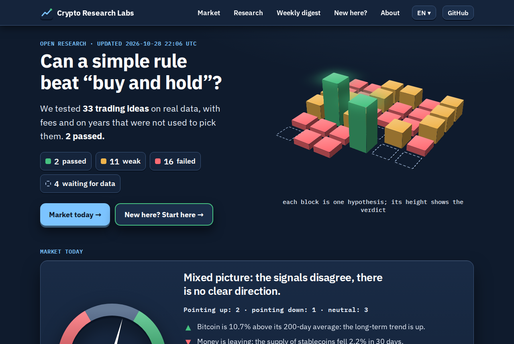
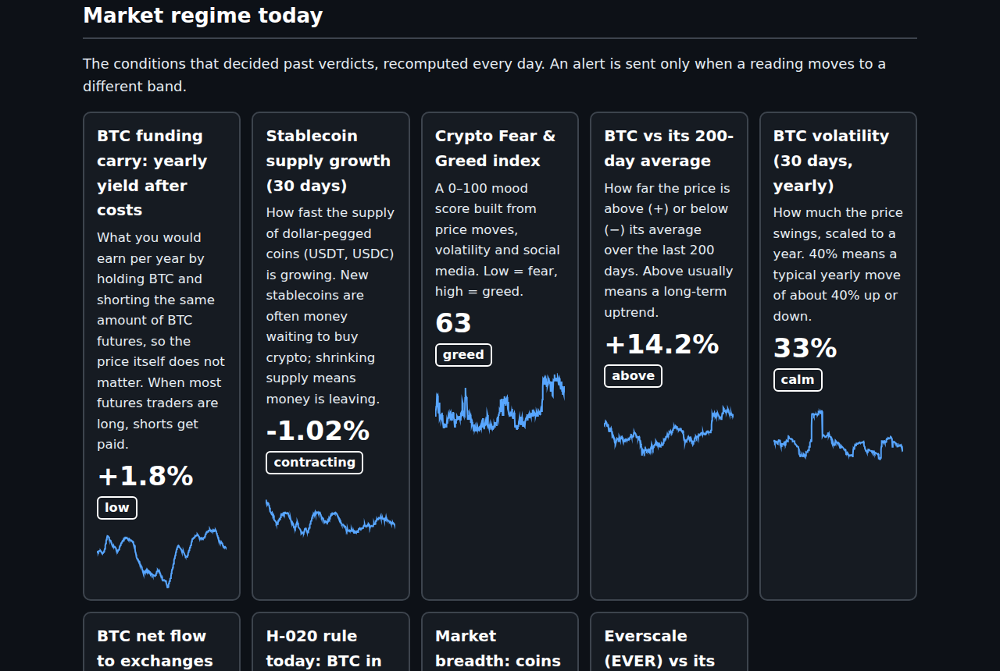
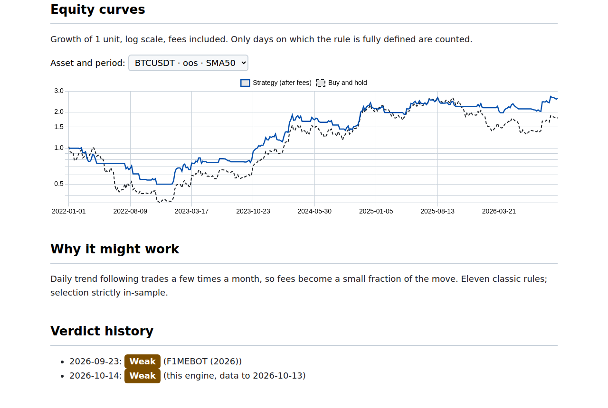
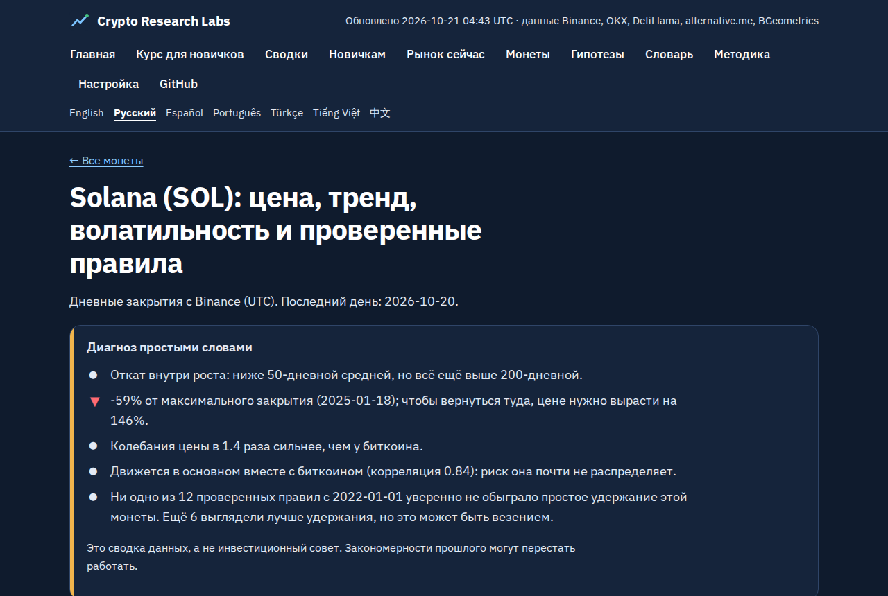
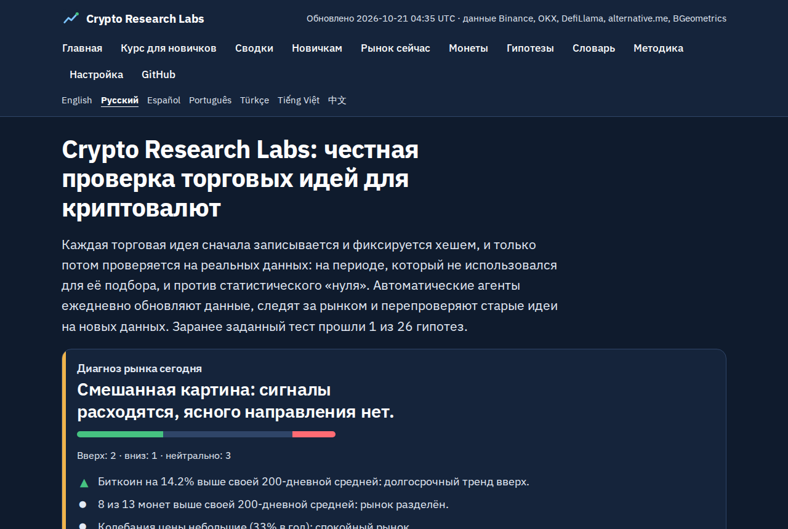
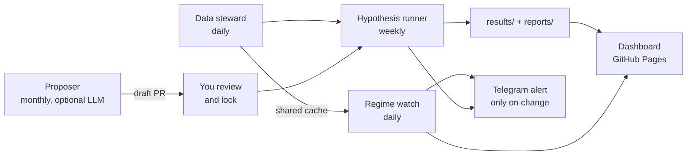

<div align="center">

# Crypto Research Labs

**Can a simple, published trading rule beat just buying a coin and holding it?**
This project checks honestly. Every idea is written down and locked *before* it is tested,
and automated agents re-test old ideas as new market data arrives.

[](https://f1devbin.github.io/Crypto-Research-Labs/)
[](https://github.com/f1devbin/Crypto-Research-Labs/actions/workflows/ci.yml)
[](https://github.com/f1devbin/Crypto-Research-Labs/actions/workflows/research-agents.yml)
[](LICENSE)


[English](https://f1devbin.github.io/Crypto-Research-Labs/) ·
[Русский](https://f1devbin.github.io/Crypto-Research-Labs/ru/) ·
[Español](https://f1devbin.github.io/Crypto-Research-Labs/es/) ·
[Português](https://f1devbin.github.io/Crypto-Research-Labs/pt/) ·
[Türkçe](https://f1devbin.github.io/Crypto-Research-Labs/tr/) ·
[Tiếng Việt](https://f1devbin.github.io/Crypto-Research-Labs/vi/) ·
[中文](https://f1devbin.github.io/Crypto-Research-Labs/zh/)



</div>

> **Not financial advice.** This is a research project. It does not trade, manage money or sell signals.
> A "pass" means "worth a closer look", not "this makes money".

## New here? Start with this

| You want to… | Go to |
|---|---|
| Learn from zero, step by step | the **[course for beginners](https://f1devbin.github.io/Crypto-Research-Labs/course.html)**: 10 short lessons in 7 languages, numbers updated daily ([на русском](https://f1devbin.github.io/Crypto-Research-Labs/ru/course.html)) |
| See today's market and every result, with plain-language explanations | the **[live dashboard](https://f1devbin.github.io/Crypto-Research-Labs/)** (7 languages) |
| Understand the words (Sharpe, drawdown, p-value, funding…) | the glossary on the dashboard, or [docs/GETTING_STARTED.md](docs/GETTING_STARTED.md) |
| Know what was found | [docs/FINDINGS.md](docs/FINDINGS.md) |
| Which coins | BTC, ETH, SOL; for independent confirmation BNB, XRP, ADA, LTC, LINK, DOGE, XLM, TRX; Everscale (EVER) and Gram (GRAM, prev. Toncoin) from Gate.io. Any Binance spot pair can be added |
| Run it yourself or add your own idea | [Quickstart](#quickstart) and [CONTRIBUTING.md](CONTRIBUTING.md) |

**The short answer so far: one idea passed (H-020, exchange deposits), and it is still being verified.** Daily trend rules and
volatility targeting lower drawdowns, mostly because they spend less time in the market, but they
don't win by a margin that luck can't explain. Fast minute-level signals lose to fees, and the
famous calendar effects (Monday, turn of the month) did not survive after their papers were published.

## What the dashboard shows

| Market regime: what the market looks like today | One hypothesis: numbers and equity curve |
|---|---|
|  |  |

| One coin: chart, numbers and what each tested rule says today | Russian version |
|---|---|
|  |  |

Every coin has its own page (BTC, ETH, SOL, BNB, XRP, ADA, LTC, LINK, DOGE, XLM, TRX, EVER, GRAM) with trend, volatility,
distance from its peak, what $100 invested a year ago is worth today and its correlation with Bitcoin, for example
[Solana](https://f1devbin.github.io/Crypto-Research-Labs/coins/SOLUSDT.html) or
[Everscale](https://f1devbin.github.io/Crypto-Research-Labs/ru/coins/EVERUSDT.html).

The site is rebuilt every day by GitHub Actions from real Binance, OKX, DefiLlama,
alternative.me and BGeometrics data. Every page is fully rendered HTML, with `hreflang` language
versions, a sitemap and structured data, so it is readable without JavaScript and by search engines.

## What we know so far

| ID | Hypothesis | Verdict |
|----|------------|---------|
| H-001 | Minute-level indicator ensemble predicts 1–4 h direction | ❌ Fail |
| H-002 | Inverted minute signals are profitable after fees | ❌ Fail |
| H-003 | Best daily trend rule (chosen 2018–2021) beats buy-and-hold out of sample | ◐ Weak |
| H-004 | Same, long/short futures | ◐ Weak on Sharpe, with drawdowns down to −87 % |
| H-005 | SMA50 long/flat beats buy-and-hold on 8 independent coins | ❌ Fail |
| H-006 | BTC long when stablecoin growth is above its 1-year median | ◐ Weak |
| H-007 | BTC out of the market when funding is in its top 20 % | ❌ Fail |
| H-008 | BTC out of the market when Fear & Greed ≥ 75 | ❌ Fail |
| H-009 | BTC long only after positive 5-day spot-ETF flow | ◐ Weak |
| H-010 | Stablecoin timing beats buy-and-hold on 8 independent coins | ❌ Fail |
| H-011 | BTC funding carry (spot long + perp short) | ❌ Fail (~1.5 %/yr recently) |
| H-012 | Volatility targeting (30 %/yr) on BTC, ETH, SOL | ◐ Weak: better Sharpe on 3/3, not significant |
| H-013 | Volatility targeting on 8 independent coins | ◐ Weak: 8/8 since 2022, 5/8 since 2019 (6 needed) |
| H-014 | 1-week momentum (Liu & Tsyvinski) on BTC, ETH, SOL | ◐ Weak: works on SOL, fails on BTC |
| H-015 | Monday effect in BTC | ❌ Fail |
| H-016 | Turn-of-the-month effect in BTC | ❌ Fail |
| H-017 | Altcoins only while BTC is above its 200-day average | ❌ Fail: 7/8 since 2022, 1/8 since 2019 |
| H-018 | Everscale (EVER): SMA50 trend rule | ◐ Weak: −10 %/yr vs −70 %/yr holding, not significant |
| H-019 | Everscale (EVER): only while BTC is above its 200-day average | ◐ Weak |
| H-023 | Gram (GRAM, prev. Toncoin): SMA50 trend rule | ⏳ Registered, first run on the next scheduled job |
| H-020 | BTC out of the market after heavy net deposits to exchanges | ✅ **Pass** (Sharpe 0.83 vs 0.50, p = 0.010); look-ahead check in H-022 |
| H-021 | Same for ETH | ◐ Weak (0.40 vs 0.22, p = 0.082) |
| H-022 | Forward replication of H-020 on as-published data | ⏳ collecting data, test on 2027-10-15 |

The live table is in [reports/RESULTS.md](reports/RESULTS.md) and on the dashboard.

## How it works



| Agent | When | What it does |
|-------|------|--------------|
| **Data steward** | daily | Updates one shared data cache and checks it for gaps, stale series, duplicates and outliers |
| **Regime watch** | daily | Tracks funding carry, stablecoin growth, sentiment, trend and volatility; alerts **only when a reading changes band** |
| **Hypothesis runner** | weekly | Re-tests every due hypothesis the same way, stores JSON results, alerts when a verdict changes |
| **Digest** | weekly | A short summary of data, regime and results (optionally rewritten by Claude) |
| **Dashboard** | daily | Builds the multilingual site and publishes it to GitHub Pages |
| **Proposer** *(optional, LLM)* | monthly | Claude drafts new hypotheses; they are validated, de-duplicated and opened as a PR for a human to review |

The LLM can't run tests or change verdicts. A human locks every draft (SHA-256) before it is
ever tested. Why it's built this way: [docs/INEFFICIENCIES.md](docs/INEFFICIENCIES.md).

## Quickstart

You need Python 3.10+ and git.

```bash
git clone https://github.com/f1devbin/Crypto-Research-Labs
cd Crypto-Research-Labs
python -m venv .venv && . .venv/bin/activate      # Windows: .venv\Scripts\activate
pip install -e ".[dev]"

pytest -q                 # self-tests: finds planted effects, rejects noise, no look-ahead
crl registry check        # every hypothesis valid, locked and unique
crl data refresh          # download market data into ./data (first run: ~15 minutes)
crl run --force           # re-test all hypotheses
crl watch                 # today's market regime -> reports/regime.md
crl site                  # build the dashboard into ./_site (open _site/index.html)
```

### Run your own copy on GitHub

1. Fork the repository.
2. **Settings → Pages → Source: GitHub Actions.**
3. **Actions → research-agents → Run workflow.** The first run takes about 20 minutes.
   After that it runs on its own every day.

Optional settings (*Settings → Secrets and variables → Actions*):

| Name | Kind | What it does |
|------|------|--------------|
| `TELEGRAM_BOT_TOKEN`, `TELEGRAM_CHAT_ID` | secret | sends alerts to Telegram |
| `ANTHROPIC_API_KEY` | secret | turns on the proposer and the LLM digest |
| `CRL_LLM_MODEL` | variable | overrides the model (default `claude-sonnet-5-5`) |
| `GOOGLE_SITE_VERIFICATION` | variable | Search Console HTML-tag code, added to every page |
| `CRL_SITE_URL` | variable | dashboard URL if you use a custom domain |

For the proposer to open PRs, turn on *Settings → Actions → General → Allow GitHub Actions to
create and approve pull requests*.

GitHub's runners are in the US, where `fapi.binance.com` answers HTTP 451. Recent funding
therefore comes from OKX. Binance's historical archives aren't blocked.

## Project layout

```
src/crl/data/       downloading, caching and checking market data
src/crl/engine/     trading rules, backtest, statistics, protocol (spec -> verdict)
src/crl/agents/     data steward, regime watch, hypothesis runner
src/crl/llm/        optional Claude layer: proposer, digest
src/crl/site*.py    dashboard builder; src/crl/i18n.py holds the translations
hypotheses/         one YAML file per idea, SHA-256-locked
results/ reports/   written by the agents
config/watch.yaml   what regime watch monitors
docs/               getting started, methodology, findings, workflows
```

## Lessons kept from the past

- **One clock: UTC.** Mixing UTC and UTC+3 once created a 30-minute blind window.
- **Stops live on the exchange.** A stop held only in a bot's memory disappears when the bot goes down.
- **Prove the edge before building infrastructure.** A year of engineering went into a bot whose signals turned out worse than random.

## Contributing

New hypotheses, translations and fixes are welcome. See [CONTRIBUTING.md](CONTRIBUTING.md).

## License

MIT. See [LICENSE](LICENSE).
